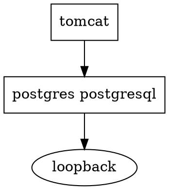

# guix system shepherd-graph

Prints the Shepherd service graph of an OS `.scm` as Dot, without building it.

```sh
guix system shepherd-graph config.scm > g.dot
```

## g.dot sample

`A -> B` = A requires B: B starts first, stopping B stops A.



`"postgres postgresql"` is one service with two provision names.

## Render

```sh
guix shell graphviz -- dot -Tsvg g.dot > g.svg
```
